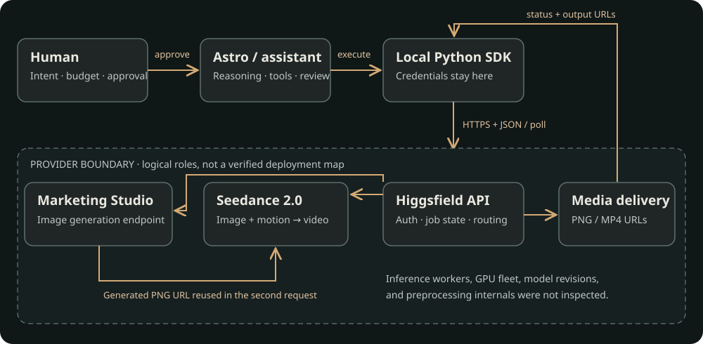

# Cracked Glass Globe

A miniature rainy fishing village inside a glass globe, made first as an image and then as a short video. This repository documents **how a language-model assistant used the Higgsfield API**: prompts, request parameters, asynchronous jobs, the image-to-video handoff, and differences between requested and delivered output.

**[Open the live walkthrough](https://az9713.github.io/cracked-glass-globe/)** · **[View the image](https://az9713.github.io/cracked-glass-globe/image.html)** · **[Play the video](https://az9713.github.io/cracked-glass-globe/video.html)**

[](https://az9713.github.io/cracked-glass-globe/)

*Click the image for the interactive GitHub Pages report. GitHub README files do not embed a running website; this preview opens the live page.*

## Watch the result

[](https://az9713.github.io/cracked-glass-globe/video.html)

[Open the player](https://az9713.github.io/cracked-glass-globe/video.html) · [MP4 file](https://az9713.github.io/cracked-glass-globe/assets/globe.mp4) · [Original PNG](https://az9713.github.io/cracked-glass-globe/assets/globe.png)

The site hosts the actual PNG and MP4. Playback makes no generation requests and spends no API credits. The published originals are byte-for-byte copies of the completed outputs; JPEG frames are diagnostic previews.

## Inspiration and scope

Inspired by **[Paul J Lipsky's “There's a Cheaper Way To Use Higgsfield (no subscription)”](https://www.youtube.com/watch?v=cnpbeFSYMG4)**. The prompt examples and starting workflow came through notes on that video. Its title and channel were verified through YouTube metadata. A full transcript audit and subscription-versus-API cost study were not performed; the title is attribution, not this project's pricing conclusion.

This is an independent technical case study, not a promotional project, sponsorship, or endorsement. No footage from Paul's video is included. The run and documentation checks date to September 23, 2026; vendor interfaces and pricing may change.

## What actually ran

| Stage | Endpoint and input | Requested | Observed |
|---|---|---|---|
| Image | `marketing-studio/image`, text prompt | 2K, 3:2, enhancement off | PNG, **2048 × 1360** |
| Video | `bytedance/seedance-2.0/image-to-video`, generated PNG URL + motion prompt | **10 seconds, 720p**, audio enabled | MP4, **1112 × 834**, **10.08 s** container duration, 24 fps, H.264 + AAC |

One image job and one video job completed. Seedance 2.5 was investigated, but **Seedance 2.0 produced the final clip**. The original PNG URL was supplied through `image_url`; the video job did not recreate its input from text.

The service changed the source proportions to 4:3. The scene is recognizable, but a pixel-identical first frame, perfect camera lock, and every requested motion have not been quantitatively certified. The cause of the aspect change is unknown. An audio stream exists; soundtrack fidelity has not been audited.

## Who talks to whom?

[](https://az9713.github.io/cracked-glass-globe/#roles)

- **Human:** supplies intent, approves paid work, and selects the model and settings.
- **Astro:** the name used here for the Codex language-model assistant. It reads documentation, assembles requests, runs tools, tracks jobs, and inspects results. The public record does not establish its exact runtime model/version.
- **Local Python SDK:** sends authenticated HTTPS requests using private credentials. The wrapper saves request IDs and prevents automatic generation retries.
- **Higgsfield API:** exposes endpoints, asynchronous job state, and output URLs. Scheduling, compute, moderation, billing, storage, and delivery are logical service roles; the diagram does not claim a verified internal deployment map.
- **Marketing Studio Image:** produces the still. Its underlying model revision was not established by the response.
- **Seedance 2.0:** produces a temporal sequence conditioned on that still and the motion prompt.
- **GitHub Pages:** serves the saved report and media. It never runs the SDK or holds a credential.

## End-to-end process

1. Read the SDK and model documentation and configure a local model-independent client.
2. Dry-run the image request and check authentication with a read-only endpoint. Neither proves all model entitlements or visual quality.
3. After human approval, submit the image request. Save the accepted ID and poll until the PNG URL arrives.
4. Inspect the real image. The inline chat preview failed, but browser inspection verified the file; no replacement generation was needed.
5. Select image-to-video and pass that exact PNG URL to the second job. Add explicit composition and camera constraints to the original motion prompt.
6. After human approval, submit Seedance 2.0 once. Save the receipt and poll the same job until it returns the MP4.
7. Play and measure the output, preserve the files, and publish the sanitized record.

The [live report](https://az9713.github.io/cracked-glass-globe/#process) includes the communication sequence, role explorer, expandable payloads, evidence labels, cost calculator, and practical failure modes.

## Exact inputs

- [Image prompt](docs/prompts/image.txt)
- [Original user video prompt](docs/prompts/video-user.txt)
- [Complete submitted video prompt, including assistant-added constraints](docs/prompts/video-submitted.txt)
- [Image request JSON](examples/globe-image.json)
- [Video request JSON](examples/globe-video.json)

The public video payload replaces the original account-scoped delivery URL with the **byte-identical GitHub Pages image**. All other generation inputs match the recorded request. Private request IDs, local paths, environment files, and raw receipts are excluded.

## Reproduce the workflow

```powershell
uv sync --locked
Copy-Item .env.example .env
# Edit .env privately and insert your own KEY_ID:KEY_SECRET credential.
uv run python hf.py doctor --online
uv run python hf.py run marketing-studio/image --input examples/globe-image.json --dry-run
```

These commands submit billable generation requests:

```powershell
uv run python hf.py run marketing-studio/image --input examples/globe-image.json
# To animate your newly generated image, replace image_url in the video JSON.
uv run python hf.py run bytedance/seedance-2.0/image-to-video --input examples/globe-video.json
```

The video example uses **this repository's globe image** unless you replace its URL. Do not mistake that convenience example for a fresh image-to-video handoff.

See [API_GUIDE.md](API_GUIDE.md) for status checks, resuming jobs, uploads, cancellation, and client limitations. Run `uv run pytest -q` for the 27 offline tests and `uv run python scripts/build_site.py` to rebuild the static report.

## Questions the happy path hides

| Issue | Practical response |
|---|---|
| A timeout can happen after the server accepted a paid job. | Save IDs immediately; resume polling. Check the console before repeating a submission with uncertain acceptance. |
| Authentication, entitlement, credits, and valid input differ. | Check the relevant boundary; a preset read is not a generation test. |
| Resolution labels and prompts are not exact output guarantees. | Measure the file and inspect source identity, framing, motion, and temporal consistency. |
| Prompts and parameters do not ensure deterministic replay. | Preserve original files and hashes. No seed or immutable model revision was recorded here. |
| Provider delivery links may expire. | Store your own copies; the provider documents at least seven days of output availability. |
| Price arithmetic is not an account debit. | Request an authenticated estimate with the full payload, then reconcile actual usage. |
| The service hides execution details. | Mark model revisions, preprocessing, GPU ownership, and inference placement as unknown unless independently evidenced. |
| Publication changes exposure. | Keep keys and raw account data out of Git and browsers. Published prompts and reference images are public. |

**Cost correction:** the original preflight calculated approximately **$3.02** for 10 seconds at **1280 × 720**, before discounts. It did not use an account quote, and the output dimensions differed. No invoice or actual charge was captured. While preparing this report, we found the documented `POST /estimate/{model}` endpoint; use it before a new generation. A current quote would not establish the historical charge.

**Client limits:** this is a local demonstration, not a production job platform. It has no billing ledger, estimate command, or webhook receiver. It reconstructs status URLs on the configured origin, whereas the official guide recommends retaining returned lifecycle URLs. Production hardening should preserve an explicit trusted-host policy rather than forwarding keys to arbitrary URLs.

## Evidence and publication

- [Sanitized manifest: settings, measured properties, sizes, and SHA-256 hashes](docs/run.json)
- [Three ordered video-frame samples](docs/assets/video-contact-sheet.jpg)
- 27 offline tests cover payload pass-through, credential handling, avoiding duplicate submissions, polling, and upload isolation.
- The PNG contains standard image-data chunks. The MP4 metadata contains codec/container tags, not local paths or account identifiers.
- The published PNG and MP4 were not cropped, resized, or re-encoded.
- No claim is made about exclusive ownership or blanket commercial clearance of generated media. Third-party source material and service terms retain their own conditions.

GitHub Pages publishes `main:/docs`. The README links to the live report and dedicated image/video pages.

## Sources

- [Paul's video](https://www.youtube.com/watch?v=cnpbeFSYMG4)
- [SDK documentation](https://docs.higgsfield.ai/docs/how-to/sdk) and [Python SDK source](https://github.com/higgsfield-ai/higgsfield-client)
- [Marketing Studio Image API](https://open.higgsfield.ai/models/marketing-studio/image/api-reference)
- [Seedance 2.0 image-to-video API](https://open.higgsfield.ai/models/bytedance/seedance-2.0/image-to-video/api-reference)
- [Request lifecycle](https://docs.higgsfield.ai/docs/concepts/requests)
- [Errors and retries](https://docs.higgsfield.ai/docs/concepts/errors)
- [Billing, estimation, and retention](https://docs.higgsfield.ai/docs/concepts/billing-and-retention)
- [Published Seedance 2.0 pricing](https://open.higgsfield.ai/models/bytedance/seedance-2.0/image-to-video/playground)
